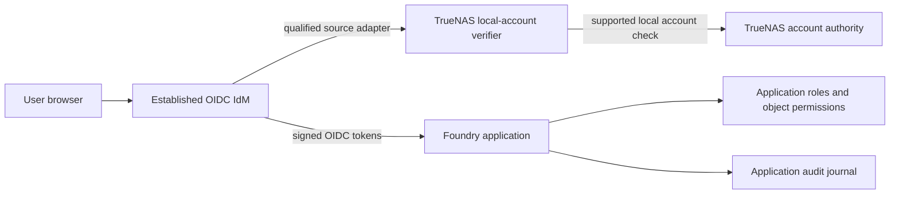

# Shared TrueNAS account identity integration

Status: source architecture for qualification. No TrueNAS local-account federation or OIDC endpoint is implemented by this document. The current runtime target is TrueNAS SCALE Apps. Private exact-target qualification and promotion are separate authorities.

## Purpose and boundary

Several Foundry source applications need to let named TrueNAS accounts sign in without giving ordinary application users NAS administration rights. A reusable TrueNAS account source should authenticate the account once through a qualified TrueNAS mechanism and supply identity to an established IdM. Each application consumes a standard OIDC identity and owns its own roles, object permissions and accounting. The Foundry does not become a password database, a token issuer or a universal authorization service.

TrueNAS 25.04 is a client of Active Directory or LDAP. It does not expose its local user database as a general OIDC or LDAP identity provider. Middleware `auth.login_ex` is suitable for accounts granted middleware privileges, but its privilege gate prevents using it as a general local SMB-user verifier. An ordinary application's user must never receive TrueNAS WebUI/API privileges as a login workaround. The official TrueNAS Apps catalog offers Keycloak, Authentik and Authelia on its Community train as OIDC IdM candidates; none automatically verifies TrueNAS local accounts. Keycloak documents a User Storage SPI for external user and credential stores, making it the first extension point to evaluate. This is a candidate, not a ready TrueNAS provider. A `pam_authelia` module authenticates a host *against* Authelia and does not solve this source direction.

Keycloak provider packaging in the exact catalog App and its User Storage SPI compatibility must be proved before implementation. Authentik's documented Password stage supports its own database, LDAP-backed passwords and Kerberos-backed passwords; a generic host-PAM source is not listed. Therefore Authentik must not be described as a ready TrueNAS-local-account bridge. Its exact extensibility and maintenance burden are part of source discovery.

A site already using an external AD/LDAP identity authority can connect its established OIDC IdM to that authority. That is a distinct route from verifying TrueNAS-local accounts. TrueNAS 25.04 LDAP clients cannot use LDAP authentication for SMB.

## Contract between components

The verifier is a target-specific adapter, not an OIDC issuer. Before any implementation is chosen, prove that the selected IdM has a maintained integration point that can consume an external credential verdict. If it does not, evaluate another established IdM or a separately qualified minimal bridge. The initial candidate is a Keycloak User Storage SPI provider that delegates only credential/account verification to a protected TrueNAS-local mechanism; Keycloak remains the OIDC issuer. Do not silently substitute a new bespoke IdM.

Minimum verifier output, only after successful authentication and account-status checks:

- a namespace for this exact TrueNAS installation and a stable local account identity; never a username alone;
- account source (`local` versus directory-backed) and current enabled/locked state;
- qualified group identities needed for application role mapping;
- authentication time and method, including whether the site's required MFA was satisfied;
- a bounded request identity for audit correlation, without password, OTP or reusable bearer token.

The IdM binds that result to its own immutable OIDC `issuer` and `sub`. Applications use `(issuer, sub)` as the principal key. Any local account deletion/recreation, UID/SID reuse or ambiguous link must fail closed and require explicit account relinking. An app must not infer equality from matching usernames or email addresses across identity sources.

The adapter must not provide general middleware access, password storage, account CRUD, arbitrary PAM service selection, unrestricted host sockets, shadow/passdb mounts or root-equivalent container access. It needs request limits, secure transport, replay protection and auditable failures. Token issuance, browser sessions, MFA enrollment and federation stay in the selected established IdM; application authorization and action accounting stay in the application.

## Qualification sequence

1. **Source discovery:** on the exact TrueNAS release, verify local/PAM/middleware behavior and the actual supported integration point in a catalog IdM. Record exact upstream identities and a public-safe design; private host observations remain in the private qualification authority.
2. **Source implementation:** build only the narrow verifier/IdM adapter selected by discovery. Pin dependencies and define an explicit failure mode for absent IdM, unavailable account source, disabled account, stale groups and ambiguous identity. Do not change host PAM, sudo, users or middleware to make tests pass.
3. **Static qualification:** synthetic valid/invalid ordinary and administrative accounts; disable, lock, password rotation, group change, deletion/recreation, same-name cross-source collision, MFA, outage, replay and rate limit. Prove ordinary app access without NAS privilege elevation.
4. **Target-profile qualification:** execute and observe on an exact TrueNAS SCALE version with bounded, namespace-owned, reversible operations and a separate site admission. Source rendering, target lowering and successful deployment-artifact generation alone do not qualify account authentication.
5. **Consumer integration:** qualify at least two applications against the same identity source. Each supplies its own role mapping, permission decisions, session policy and accounting. FolioRelay is the first proposed consumer.

The public Foundry may package generic target-specific integration mechanics. The private Foundry retains exact-candidate promotion and protected target evidence. Product defects stay with the product development authority.

## Other runtime targets

FolioRelay and other apps must keep OIDC integration independent of TrueNAS. Docker Compose, Podman Compose, TrueNAS Containers, Proxmox LXC, native systemd and Podman Quadlet are future runtime targets or target profiles only. Each requires its own target lowering, deployment artifact, runtime realization and target-profile qualification. For each, qualify IdM endpoint discovery, callback URL/TLS, secret delivery, session persistence and offboarding. Host-account login on another target is a separate adapter claim; TrueNAS local-account proof cannot be transferred to it.

## References

- [TrueNAS 25.04 directory services](https://www.truenas.com/docs/scale/25.04/scaletutorials/credentials/directoryservices/)
- [TrueNAS 25.04 LDAP and SMB limitation](https://www.truenas.com/docs/scale/25.04/scaletutorials/credentials/directoryservices/configldapscale/)
- [TrueNAS Apps Market: Keycloak](https://apps.truenas.com/catalog/keycloak_community/)
- [Keycloak User Storage SPI](https://www.keycloak.org/docs/26.4.7/server_development/#_user-storage-spi)
- [TrueNAS Apps Market: Authentik](https://apps.truenas.com/catalog/authentik_community/)
- [TrueNAS Apps Market: Authelia](https://apps.truenas.com/catalog/authelia_community/)
- [Authelia PAM integration direction](https://www.authelia.com/integration/guides/pam-authelia/)
- [Authentik Password stage supported backends](https://docs.goauthentik.io/add-secure-apps/flows-stages/stages/password/)
